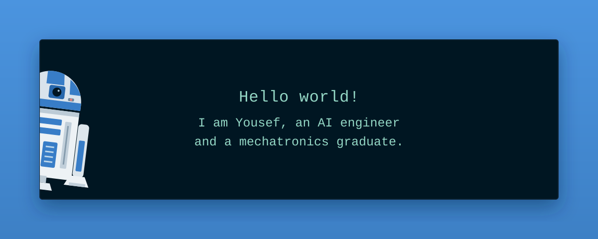

  

  
<strong>AI Engineer · LLM Applications · Multi-Agent Systems · Automation</strong>

  

    
    
    
  

  
Cairo, Egypt · Open to full-time AI Engineering &amp; AI Automation opportunities

---

## From physical systems to intelligent software

I’m **Yousef Alsayed Abdelfattah**, an AI engineer with a background in mechatronics and robotics. I started with embedded C and autonomous robots; today, I build LLM applications, coordinated agents, and automations that connect models to useful actions.

My work spans **document-grounded answers, agent orchestration, and real-time robot monitoring**. I care about the engineering around the model: clear interfaces, useful evaluations, observable workflows, and tests that catch failures.

Currently, I’m an **AI Engineering Intern at Arche Robotics** and an **English-speaking Programming Instructor at iSchool**. Previously, I worked on LLM evaluation and RLHF at Outlier.

## Engineering in practice

- **Real-time fleet monitoring · Arche Robotics.** Reworked a Python/AWS monitoring agent from **30-minute polling** to DynamoDB Stream triggers with **~0.3-second log capture**. Added a six-stage inference skip ladder to control LLM usage.
- **Reliability · Arche Robotics.** Built a local-to-cloud testing harness, resolved **nine production issues**, and validated changes with **265 Pytest unit tests and 13 live-stream smoke tests**.
- **LLM evaluation · Outlier.** Evaluated **50+ model responses daily** across six or more domains and developed **20+ prompt variations** to investigate hallucinations and reasoning failures.
- **Teaching · iSchool.** Taught **30+ students** across Grades 1–12 through projects in Python, AI, JavaScript, and UI/UX.

## Selected builds

These projects show how I approach different parts of an AI system: retrieval, orchestration, delivery, deployment, and interaction with the physical world.

### 01 · [Advanced Engineering Team](https://github.com/yousefattaff/advanced_engineering_team)

Engineering lead, backend, frontend, and QA agents coordinate to generate software and tests, with Docker-based execution and tracing.  
**Built with:** CrewAI · Groq · Docker · Langfuse

### 02 · [RAG AI Agent](https://github.com/yousefattaff/RAG-AI-Agent)

Uploaded PDFs become named experts with document retrieval, filename/page citations, and optional research and voice tools.  
**Built with:** LangChain · ChromaDB · Streamlit

### 03 · [SDR Multi-Agent](https://github.com/yousefattaff/SDR_Multi_Agent)

A prospect-research and outreach pipeline that produces competing email drafts, applies guardrails, and delivers the selected message with tracing.  
**Built with:** OpenAI Agents SDK · Tavily · SendGrid · Langfuse

### 04 · [EgyptianSavoryScout](https://github.com/yousefattaff/EgyptianSavoryScout)

Restaurant recommendations from **1,000+ Egyptian locations**, combining city filters and TF-IDF ranking with local-model explanations.  
**Built with:** FastAPI · React · Hugging Face

### 05 · [AI Digital Twin](https://github.com/yousefattaff/YousefAlsayed-DigitalTwin)

An interactive portfolio with a conversational assistant grounded in my career and project documents.  
**Built with:** Next.js · React · Groq

### 06 · [R2-WAITER](https://github.com/yousefattaff/R2-WAITER)

A TurtleBot3 restaurant workflow with three-tray orders, sequential navigation goals, animated expressions, and recovery handling.  
**Built with:** ROS 2 · Nav2 · Python · PyQt5

<strong>The embedded foundation</strong>

My **[ATmega32 Drivers & Applications](https://github.com/yousefattaff/Atmeg32_IMT)** repository separates microcontroller access, reusable hardware drivers, and application examples into MCAL, HAL, and application layers. It includes interfaces for displays, keypads, motors, switches, and ultrasonic sensors.

That background still shapes how I build software: understand the interfaces, account for failure modes, and test the complete system.

## Tools I work with

| Area | Toolkit |
| :--- | :--- |
| **Agents & automation** | OpenAI Agents SDK, CrewAI, LangGraph, n8n, MCP, FastMCP |
| **Retrieval & model work** | LangChain, ChromaDB, PyTorch, Hugging Face, QLoRA experiments, LLM evaluation |
| **Backend & reliability** | Python, FastAPI, Pydantic, Pytest, Langfuse, Docker, Git |
| **Cloud & event-driven systems** | AWS Lambda, AWS SAM, DynamoDB Streams, S3, API Gateway |
| **Interfaces & robotics** | Next.js, React, JavaScript, embedded C, ROS 2, Nav2 |

## Learning that informs the work

**B.Sc. in Mechatronics, Robotics & Automation Engineering**  
Misr University for Science and Technology · 2019–2024

Alongside that foundation, I’ve completed **Harvard/edX CS50 and CS50 AI**, the **[Machine Learning Specialization](https://coursera.org/verify/specialization/SQB1UP61HNRH)** from Stanford Online and DeepLearning.AI, and Ed Donner/Ligency courses covering LLM engineering, agents and MCP, production deployment, coding agents, and n8n automation.

---

  <h3>Have an AI system to build?</h3>
  
I’m interested in AI engineering roles and collaborations involving agents, retrieval, automation, or robotics.

  
<a href="mailto:yousefabuelkhear@gmail.com"><strong>Let’s talk</strong></a> · <a href="https://www.linkedin.com/in/yousef-alsayed-abdelfattah">LinkedIn</a> · <a href="https://yousefalsayed.me">Portfolio</a>

  Ground the answers. Trace the actions. Test the system.

